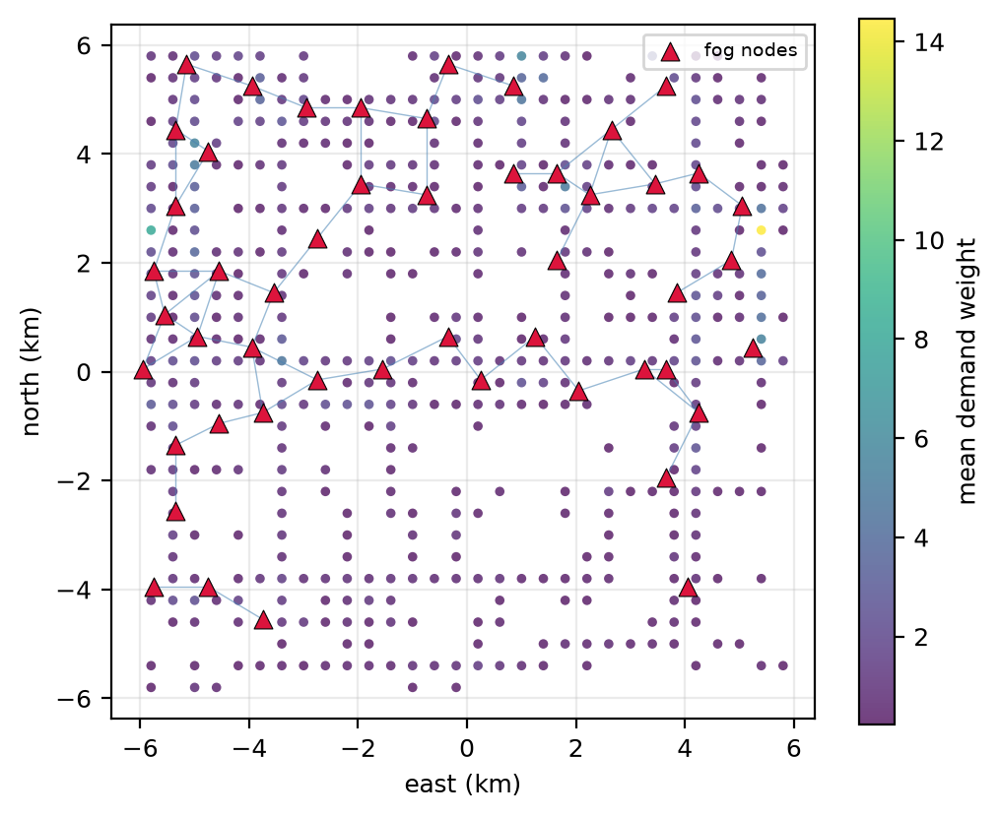

# FogField

Code and results for **"FogField: Fully Decentralized Repositioning of UAV-Mounted Fog Nodes via
Potential Games and Gossip"** (Amr H. Abdelhaliem, Irbid National University; manuscript prepared for
*IEEE Transactions on Network and Service Management*).

FogField repositions UAV-mounted fog nodes with no central controller. Repositioning is formulated as an
exact potential game over the communication graph: players are nodes, strategies are the lattice cells
reachable in one slot, and each node's marginal-contribution (wonderful-life) utility has the global
coverage, connectivity, energy objective as its potential. Nodes play the game by best response with inertia
(FogField-BR) or by log-linear learning with an annealed inverse temperature (FogField-LLL), using only a
bounded neighbour view maintained by push-pull gossip. The gossip cost is *measured* by running the real
serialisation codec and counting payload bytes, and the node energy follows the Zeng, Xu and Zhang
rotary-wing propulsion model.



## What the evaluation covers

- **Two open testbeds**: MEL (EUA dataset, Melbourne CBD: 816 real user locations, runs seeded from 125 real
  base-station sites) and BEJ (GeoLife, Beijing: 500 demand cells over 48 real time-of-day slots, pooled
  across days into a diurnal demand surface).
- **Nine dynamic scenarios**: static, mobility, random failures, traffic shift, expansion, catastrophic
  (50 % simultaneous loss), flash crowd, seed loss, and byzantine (15 % of nodes gossip falsified state).
- **Baselines sharing the same runner and measurement harness**: GossipGreedy, Guerrero-style, Consensus-ADMM
  and MARL-IQL (decentralised); a D-POA-style centralised swarm; Static and RandomWalk; and an exact CBC MILP
  bound on small instances.
- **Diagnostics**: a numerical check of the exact-potential identity (65 profiles, zero violation), an
  epsilon-Nash test on the global potential, a locality gap between the neighbour-only utility estimator and
  the true marginal contribution, and a checkpoint-resume self-test (bit-identical traces).
- **Scale**: 1,738 checkpointed work units: 1,620 main grid (2 testbeds × 9 scenarios × 9 algorithms ×
  n ∈ {20, 50} × 5 seeds), 81 scalability (50 to 800 nodes), 25 MILP, 12 equilibrium.

### Headline results

| Method | MILP gap, mean % (25 inst.) | BEJ static, Φ | BEJ catastrophic, Φ | Payload B/node/round, n = 800 |
|---|---|---|---|---|
| **FogField-BR** | 3.76 | **0.505** | **0.285** | 267.0 |
| FogField-LLL | 8.05 | 0.450 | 0.281 | 268.4 |
| D-POA-style (centralised) | **3.67** | 0.344 | 0.248 | – |
| GossipGreedy | 59.95 | 0.359 | 0.275 | 266.7 |
| Guerrero-style | 27.02 | 0.276 | 0.213 | – |
| Consensus-ADMM | 69.45 | 0.168 | 0.138 | 265.6 |
| MARL-IQL | 112.64 | 0.150 | 0.066 | – |
| Static | – | 0.280 | 0.185 | 270.0 |

- FogField-BR matches the centralised reference on the optimality gap (paired t-test p = 0.94) using
  neighbour-only information, and both FogField variants sit an order of magnitude inside the 50 % worst
  case that the PoA ≤ 2 bound admits.
- On BEJ, FogField improves the objective over the best non-FogField baseline in every scenario (+3.6 % to
  +40.7 %). On MEL coverage saturates above 99 % for every competent method, so that testbed does not
  discriminate; the paper reports this as a negative result.
- Per-node payload grows only from 127 to 267 bytes per round as the network grows from 50 to 800 nodes.
- FogField-LLL reaches a 1 % epsilon-Nash equilibrium in every run while each node knows under 30 % of the
  network.
- **Limits, reported in the paper**: FogField degrades more under falsified gossip than simpler heuristics
  (−6.5 % and −9.9 % against −1.2 %); it is slowest to regain 95 % of its pre-event objective after
  catastrophic loss, a metric the paper shows is confounded by pre-event quality (r² = 0.69); the measured
  cost is application-layer payload only (no MAC, retransmission or loss); the MILP omits the connectivity
  constraint and is a relaxation.

All numbers come from the ledger in `results/ledger.zip`; `results/tables/` and `results/figures/` are
generated from it.

## Repository layout

```
FogField_Q1.ipynb          the whole study as one Colab-style notebook (compiled from code/parts/)
code/
  fogfield_src_fullrun.py  the notebook as a script, configured for the paper-scale grid (QUICK = False)
  fogfield_src.py          the same source with the quick Colab configuration (QUICK = True)
  parts/01..10_*.py        the ten sections the source is assembled from
  driver.py                run the script headless: --mode grind (resumable, 50-min budget per call)
                           or --mode analysis (tables and figures from the ledger, no re-computation)
  restore_ledger.py        unpack results/ledger.zip and data/cache/ into code/fogfield_out_full/
  make_paper_figs2.py      paper-style vector figures
  build_notebook.py        compile the # %% source into the .ipynb
  smoke.py                 execute every code path on a shrunken grid
  tools/                   author's helpers: priority pass for the MILP/equilibrium studies, LaTeX
                           packaging, Word conversion, this repository's assembly script
results/
  run_manifest.json        datasets, UAV parameters, weights, grid, verification results
  potential_check.json     exact-potential identity check (uncapacitated and capacitated)
  resume_selftest.json     checkpoint-resume self-test
  ledger.zip               1,738 work-unit records (one JSON each, with per-round traces)
  tables/                  table1..6 as CSV and LaTeX
  figures/                 paper figures (PDF + PNG) and notebook diagnostics
data/cache/
  eua_melbcbd_816.npz      EUA Melbourne CBD devices and sites, projected to metres
  geolife_u60_g400_s30_c500.npz   GeoLife Beijing demand surface (400 m grid, 30-min slots, 500 cells)
```

## Data

Both testbeds are built from public datasets that the script downloads itself when the cache is absent.
The derived caches in `data/cache/` are small and let the analysis run without any download.

| Testbed | Source | Licence / terms |
|---|---|---|
| MEL | EUA dataset, `swinedge/eua-dataset` on GitHub (Lai et al., ICSOC 2018): Optus base-station sites and user locations in Melbourne CBD | as published by the EUA authors |
| BEJ | GeoLife GPS Trajectories v1.3 (Microsoft Research Asia; Zheng et al.): 18,670 trajectory files, binned to a 400 m grid and 48 time-of-day slots, pooled across days | Microsoft Research licence; only the aggregated demand surface is redistributed here |

The Telecom Italia Milano grid is not used because it requires a Dataverse guestbook response.

## Reproduce

Tested with Python 3.11 on Windows 11, CPU only.

```bash
pip install -r requirements.txt
cd code
python restore_ledger.py                 # ledger + caches -> code/fogfield_out_full/
python driver.py --mode analysis         # regenerates every table and figure from the ledger
python make_paper_figs2.py               # paper-style vector figures -> code/paper_figs/
```

To re-run the experiments, delete `code/fogfield_out_full/results/` and call
`python driver.py --mode grind` repeatedly; every work unit is checkpointed with its RNG state, so a
resumed run is bit-identical to an uninterrupted one. The full grid took about four and a half hours of
wall-clock time on the author's desktop CPU (23 Sep 2026, see the released run logs). The notebook does the same on a free Colab session with checkpoints on Google Drive.

The run logs from the author's runs are attached to the GitHub release as `fogfield_run_logs.zip`.

## License

MIT; see `LICENSE`.
